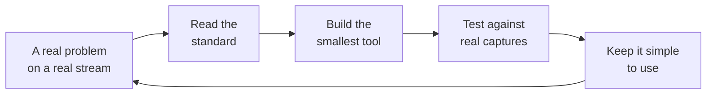

# Jake

**Systems engineer, broadcast and streaming technology**

*Everything is figuroutable.*

---

## About

I work with video transport streams, packet captures and the signalling that rides inside them. I like building small, accurate tools that make a hard-to-see problem easy to see, and I check them against the standards rather than trusting them.

## What I work on

| Area | What it covers |
|---|---|
| Streams | MPEG transport streams, UDP, RTP and SRT, live and recorded |
| Signalling | Ad-insertion cues, timing against the video, standards compliance |
| Tools | Python utilities with simple interfaces, built to be checked and trusted |
| Learning | Cloud (AWS and Azure), machine learning |

## How I build a tool

## Tech

Languages and tools

 

| | |
|---|---|
| Languages | Python, JavaScript, PowerShell, Bash |
| Streaming | MPEG-TS, SRT, RTP, HLS, DASH |
| Tools | Wireshark and tshark, TSDuck, FFmpeg, Git |
| Cloud | AWS, Azure (learning) |

## GitHub in numbers

| | As at 2 November 2026 |
|---|---|
| Contributions in the last year | 105 |
| Repositories | 2 (both private for now) |

---

*This page is hand-written. The numbers are updated when I remember to.*

